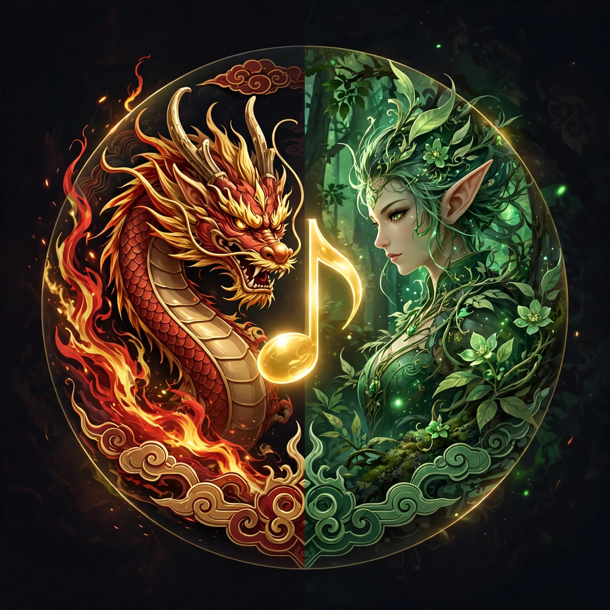

# 🔥🧝 Dragon Elf Music Player

A beautiful fantasy music player with **TWO worlds** in ONE app.

**Fire Dragon** for powerful music. **Elf** for calm, magical music.
Built with **Rust + React + Local Storage**.

---

## ✨ Features

### 🔥 Version 1: Fire Dragon
- Chinese fantasy style - Red, Black, Gold
- Fire Dragon head + body wrapping the GUI
- Fire-shaped edges, flames, glowing effects
- For energetic / powerful music

### 🧝 Version 2: Elf
- Elf fantasy style - Green, Jade, Gold, White
- Forest Elf, magic leaves, glowing forest
- Soft, elegant, magical
- For calm / beautiful music

### 🎵 Music Player
- Play / Pause / Next / Previous
- Shuffle / Repeat
- Volume control
- Progress bar / Seek
- Search songs
- Playlist
- Favorites ❤️
- Album art

### 💾 Local Storage
- Saves your Playlists
- Saves your Favorites
- Saves your Theme (Dragon or Elf)
- Saves Volume + Last Song
- Works offline - No internet needed

---

## 🛠️ Tech Stack

| Part | Tech |
| --- | --- |
| Frontend | React + Vite + CSS |
| Backend | Rust + Tauri |
| Storage | Local Storage + Rust File System |
| OS | MX Linux / Windows / Mac |

---

## 📁 Project Structure
